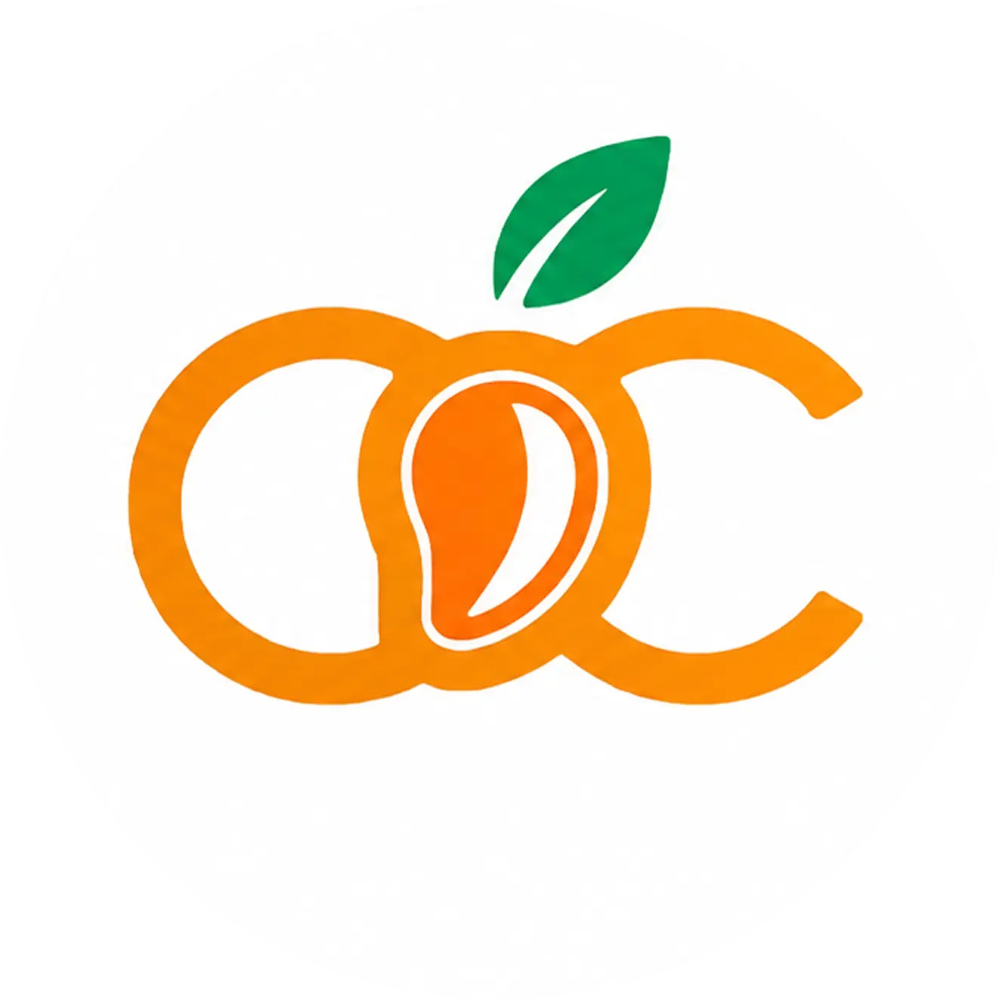

<p align="center">
  
</p>

# sustainable-farm

Digital twin and decision system for a sustainable dried mango supply chain from Burkina Faso to Germany, developed under the Infineon/BIT Excellence Program.

One web application with one module per domain: machinery, plants, product transformation, sales and marketing, visitor management, water supply and energy supply, on shared referentials for farms, people and alerts. The backend is a modular monolith (Spring Boot, one PostgreSQL database); the frontend is a React single-page application with one shell, one component kit and three languages (English, German, French).

## Tech stack

Backend (`backend/pom.xml`):


Frontend (`frontend/package.json`):


Infrastructure:


## Quick start

```bash
cp .env.example .env    # set SPRING_PROFILES_ACTIVE=dev for demo data
docker compose up -d --build
```

Then open http://localhost:3000. Details, ports and tests: [Setup](docs/SETUP.md).

## Documentation

| Document | Content |
|---|---|
| [Docs index](docs/README.md) | Every document and the reading order |
| [Architecture](docs/ARCHITECTURE.md) | Modules, shared referentials, module rules, database, API, frontend shell |
| [Setup](docs/SETUP.md) | Prerequisites, configuration, start, tests, the ARC Core gate |
| [Contributing](docs/CONTRIBUTING.md) | Branches, module ownership, commits |
| [Decision records](docs/adr/README.md) | Why the architecture is what it is |
