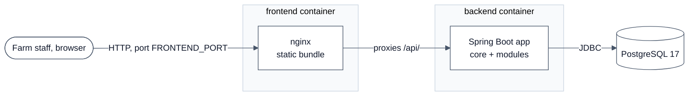
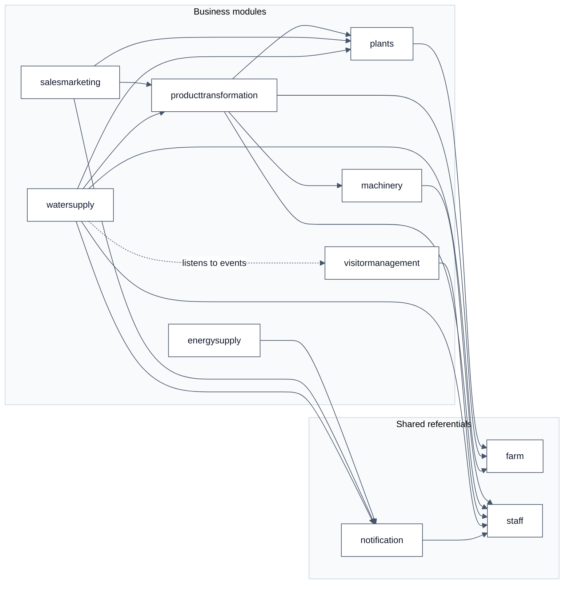
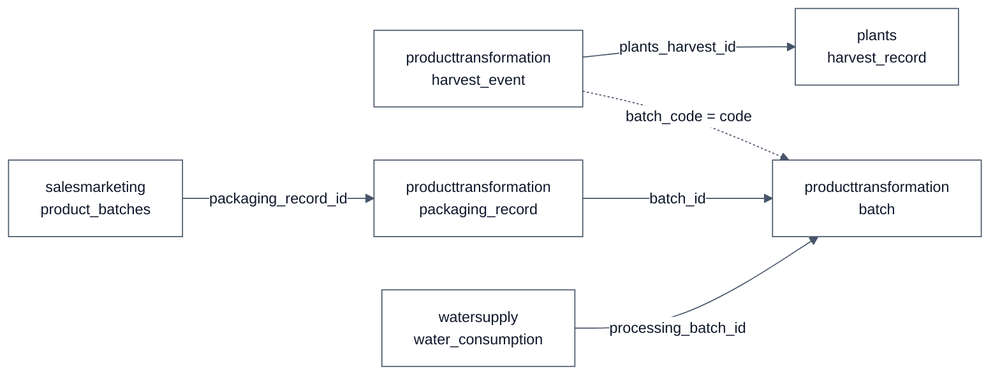

# Architecture

This document describes how sustainable-farm is built after the integration and uniformisation of its modules: one Spring Boot application split into modules, one PostgreSQL database, one React application with a single shell. It states the rules that keep the modules apart and the conventions every module follows. The reasons behind each rule are in the architecture decision records (ADR) of [adr/](adr/README.md).

## Related documents

| Document | Relationship |
|---|---|
| [Setup](SETUP.md) | How to run the stack described here and its tests |
| [Contributing](CONTRIBUTING.md) | Who may change which folder, commit rules, the gate |
| [ADR 0001](adr/0001-app-shell-et-design-system.md) | Justifies the single shell, the kit and i18n |
| [ADR 0002](adr/0002-conventions-base-de-donnees-et-api.md) | Justifies the database and API conventions |
| [ADR 0003](adr/0003-communication-entre-modules.md) | Justifies the module communication rules |
| [ADR 0004](adr/0004-referentiels-partages.md) | Justifies the owner of each shared referential |

## 1. Overview

The system is a **modular monolith**: a single Spring Boot application, deployed as one JAR in one container, backed by one PostgreSQL 17 database. Each business module is a Java package under `com.infineonbit.sustainablefarm.modules`, running in the same process. Modules never call each other over HTTP. The frontend is a single-page application (React 19, Vite 8) served by nginx, which proxies `/api/` to the backend.



| Container | Image | Published port | Source |
|---|---|---|---|
| `sustainable-farm-frontend` | `nginx:alpine`, built with `node:22-alpine` | `${FRONTEND_PORT:-3000}` to 80 | `frontend/Dockerfile`, `frontend/nginx.conf` |
| `sustainable-farm-backend` | `eclipse-temurin:21-jre-alpine`, built with `maven:3.9-eclipse-temurin-21` | `${BACKEND_PORT:-8080}` to 8080 | `backend/Dockerfile` |
| `sustainable-farm-db` | `postgres:17-alpine` | `${POSTGRES_PORT}` to 5432 | `docker-compose.yml` |

The backend starts once PostgreSQL passes `pg_isready`; the frontend starts once the backend answers `/actuator/health`. There is no authentication yet: `core.config.SecurityConfig` opens every route (out of scope of the integration, see the plan non-goals).

## 2. Backend

### 2.1 Packages

| Package | Content |
|---|---|
| `com.infineonbit.sustainablefarm` | `SustainableFarmApplication`, the entry point |
| `core.config` | `SecurityConfig` (one chain for the whole app), `WebConfig` (CORS from `app.cors.allowed-origins`), `OpenApiConfig` |
| `core.entity` | `BaseEntity`: `Long` IDENTITY `id`, `created_at` and `updated_at` as `Instant` |
| `core.exception` | `ApiError`, `CoreExceptionHandler` and the exceptions modules throw |
| `core.money` | `Money` (embeddable amount and currency), `CurrencyCode`, the `CurrencyConversion` port |
| `core.schema` | `CrossModuleForeignKey` and its installer (foreign keys between modules) |
| `core.web` | `PageResponse`, the single paged response |
| `core.notification` | `NotificationService` (e-mail, console or SMTP), distinct from the `notification` module |
| `core.validation` | `@Phone` |
| `modules.<module>` | One package per module; `modules.<module>.api` is its only public part |

`core` holds technical infrastructure only and depends on no module.

### 2.2 Modules

| Module | Purpose | Public `api` package | Owner (`.github/module-owners.conf`) |
|---|---|---|---|
| `farm` | Shared site referential: farms, blocks (fields), zones | `FarmDirectory`, `FarmDto`, `BlockDto`, `ZoneDto` | PANK4SS (admin, shared) |
| `staff` | Shared people referential: one `person` row per person, administered by the visitor management Staff screen (people directory); read-only list `GET /api/staff/persons` | `PersonDirectory`, `PersonDto`, `PersonDetails` | PANK4SS (admin, shared) |
| `notification` | Shared alert store: one `alert` table for the modules that raise alerts | `AlertBoard`, `AlertDto`, `AlertDetails`, `AlertSeverity`, `AlertStatus`, `SourceModule` | PANK4SS (admin, shared) |
| `machinery` | Equipment register, operator assignments, spare parts, maintenance, usage and fuel logs, repairs | `EquipmentLookup`, `EquipmentView` and its enums | PANK4SS |
| `plants` | Varieties catalogue, growth calendar, fertilizers, plant health, harvests and maturity, nursery, scenarios, currency rates | `VarietyCatalog`, `HarvestLookup`, `BlockGrowthLookup` | wangredelwende-spec |
| `producttransformation` | Raw intake, batches, washing and sorting, drying, quality control, compliance, packaging, processing equipment | `ProcessingBatchLookup`, `PackagedLotLookup` | SABF226 |
| `salesmarketing` | Demand forecasts and alerts, reports, customers, sales channels, pricing, campaigns, product batches, shipments | none | nishe956 |
| `visitormanagement` | Visit scheduling, registrations, visitors, education, safety, bookings, feedback, events, guides | `VisitScheduled`, `VisitRescheduled`, `VisitCancelled` (events) | ALIX6S |
| `watersupply` | Water sources, consumption, quality, irrigation, quotas, rainwater, drip maintenance, IoT, weather, outages | none | brecheyn |
| `energysupply` | Energy components, solar generation, consumption, generator backup, carbon footprint, what-if analysis, alerts | none | Dark1920 |
| `sitesecurity` | Excluded (section 6) | none | TaniaW777 |
| `cropstorage` | Excluded, empty (section 6) | none | christelle-dehoumon |

Inside a module the layers are `controller`, `service`, `repository`, `entity` and `dto`, plus `config` for its beans. producttransformation groups the same layers by feature (`batch/controller`, `batch/model`, ...).

### 2.3 Owner of each shared referential

Each concept has exactly one owner module; the others reference its rows by foreign key and read them through the owner's `api` package ([ADR 0004](adr/0004-referentiels-partages.md)).

| Concept | Owner | Table referenced | Read through | Referenced by |
|---|---|---|---|---|
| Farm, block, zone | `farm` | `farm`, `block`, `zone` (`id`) | `farm.api.FarmDirectory` | plants, producttransformation, watersupply |
| Person | `staff` (written only by visitormanagement, Staff screen) | `person` (`id`) | `staff.api.PersonDirectory` | machinery, producttransformation (`operator` extension), visitormanagement (`staff` entries, optional visitor role), watersupply, plants, salesmarketing, notification (alert recipient); consumers send a person id, never a name |
| Alert | `notification` | `alert` | `notification.api.AlertBoard`, scoped by `SourceModule` | energysupply, salesmarketing, watersupply |
| Equipment | `machinery` | `equipment` | `machinery.api.EquipmentLookup` (read only: machinery alone writes the register) | producttransformation (1:1 extension `pt_equipment_spec`), plants (`health_treatment.equipment_id`) |
| Mango variety | `plants` | `variety_reference` (`variety_key`, unique) | `plants.api.VarietyCatalog` | producttransformation, salesmarketing |
| Exchange rate | `plants` | `currency_rate` | `core.money.CurrencyConversion`, implemented by plants | any module through `core` |

### 2.4 Module communication

| Need | Mechanism | Example in the code |
|---|---|---|
| Synchronous read of another module | Call an interface of `modules.<x>.api` (interfaces and DTO records only), implemented inside module `x` | producttransformation reads harvests through `plants.api.HarvestLookup` |
| Side effect in another module | Spring event published by the source, consumed with `@TransactionalEventListener(phase = AFTER_COMMIT)` | visitormanagement publishes `VisitScheduled`, `VisitRescheduled`, `VisitCancelled`; watersupply `VisitorManagementListener` records the visit announcements |
| HTTP call to the application itself | Forbidden | |
| Error handling | Only in `core` (`CoreExceptionHandler`) | |

The dependencies between modules found in the code (imports of another module, all through its `api` package):



| Line | Meaning |
|---|---|
| Solid arrow | The source calls an interface or reads a DTO of the target's `api` package |
| Dotted arrow | The source consumes Spring events declared in the target's `api` package |

The rules are enforced by the ArchUnit test `backend/src/test/java/com/infineonbit/sustainablefarm/architecture/ModuleBoundariesTest.java`, run by every backend test run (locally and in CI):

| Rule | Content | Frozen violations (`backend/src/test/resources/archunit_store`) |
|---|---|---|
| Module boundaries | A class of `modules.<x>` depends on `modules.<y>` only through `modules.<y>.api` | none |
| Core | No class of `core` depends on a class of `modules` | not frozen |
| Errors | No class outside `core` is a `@ControllerAdvice` or is named `*ExceptionHandler` | `sitesecurity.exception.SiteSecurityExceptionHandler`, kept while the module is excluded |

A new violation fails the test. A fixed frozen violation also fails it until its line is removed from the store by hand.

### 2.5 The lot chain

A mango lot is followed from the harvest to the sale by foreign keys, without any new behaviour and without HTTP between modules.



| Link | Column | Kind | On delete of the target |
|---|---|---|---|
| Harvest event to plants harvest | `harvest_event.plants_harvest_id` | Cross-module FK `fk_harvest_event_plants_harvest` | Refused while referenced |
| Harvest event to batch | `harvest_event.batch_code` matches `batch.code` | Business code inside producttransformation, no FK (dotted line) | Not applicable |
| Packaging record to batch | `packaging_record.batch_id` | JPA FK `fk_packaging_record_batch` | Refused while referenced |
| Sales batch to packaged lot | `product_batches.packaging_record_id` | Cross-module FK `fk_product_batches_packaging_record` | Link cleared (`SET NULL`), the sales batch keeps its own code |
| Water consumption to batch | `water_consumption.processing_batch_id` | Cross-module FK `fk_water_consumption_processing_batch` | Link cleared (`SET NULL`), the consumption keeps its `lot_id` |

### 2.6 Database

| Topic | Rule | Where |
|---|---|---|
| Schema | Flyway is on and applies a single baseline migration, `V1__baseline.sql`, generated from the final entity model (Hibernate schema plus the cross-module foreign keys, dumped with `pg_dump --schema-only` and ordered: tables, keys, indexes, foreign keys; its header gives the method); Hibernate runs with `spring.jpa.hibernate.ddl-auto=validate` and only checks the schema. A later change is a new migration `V<n>__<module>_<description>.sql`; an applied migration is never edited | `backend/src/main/resources/db/migration`, `application.properties` (task T46) |
| Schema in CI | The CI replays the migrations on a fresh PostgreSQL 17 and validates the schema on every PR (task T47) | `.github/workflows/ci.yml` |
| Primary keys | `Long`, `GenerationType.IDENTITY`, from `core.entity.BaseEntity`; a unique business code next to it when one exists (lot code, block code, equipment code) | every entity |
| Audit columns | `created_at`, `updated_at` as `Instant`, set by `@PrePersist` and `@PreUpdate` | `BaseEntity` |
| Names | English snake_case, singular, module prefix only when ambiguous (`pt_equipment_spec`). Exceptions kept to freeze the JSON and the features: salesmarketing and watersupply tables stay plural (`customers`, `water_sources`), sitesecurity keeps its `site_security_*` tables | `@Table` of each entity |
| Statuses and types | Java enums stored with `@Enumerated(EnumType.STRING)` | |
| Money | `core.money.Money` embedded as `<prefix>_amount numeric(14,2)` and `<prefix>_currency varchar(3)` (`XOF`, `EUR`, `USD`) | energysupply, machinery, salesmarketing, visitormanagement |
| Quantities | `BigDecimal`, never floating point | |
| Constraints | Unique keys, nullability, lengths and indexes are declared on the entities | |
| Foreign keys inside a module | JPA associations with a named `@ForeignKey` | |
| Foreign keys between modules | A plain `Long` (or key) column in the referencing module, plus a `core.schema.CrossModuleForeignKey` bean naming the target table and column, taken from the owner's `api` constants (`FarmDirectory.BLOCK_TABLE`, `PersonDirectory.TABLE`, ...). A module never maps another module's entity | 14 `*ForeignKeys` configuration classes in the modules |
| Reference data | Loaded at startup in every profile, idempotent: the variety catalogue (`VarietyCatalogLoader`) and the IoT system person (`SystemUserSeeder`) | plants, watersupply |
| Demo data | One data set for every module, `seed/demo-data.sql`, loaded by `core.config.DemoDataSeeder` (`@Profile("dev")`, `SPRING_PROFILES_ACTIVE=dev`) after the reference data, in one transaction, only when the `farm` table is empty. Fictitious and small: one farm with fields A, B, C, the same people, machines and lots in every module, dates relative to the current date. PostgreSQL SQL, checked by `DemoDataSetTest`. sitesecurity keeps its own dev seeder | `core/config/DemoDataSeeder.java`, `backend/src/main/resources/seed/demo-data.sql` |
| Tests | H2 in memory by default (`application-test.properties`, `ddl-auto=create`); the CI overrides the datasource with PostgreSQL 17 | `backend/src/test/resources` |

The database is disposable: there is no production data, and a model change is applied by recreating the database (`docker compose down -v`).

### 2.7 API conventions

| Topic | Rule |
|---|---|
| Path | `/api/<module-kebab>/<resource>`, plural kebab-case resources, no `/api/v1` |
| Bodies | Java records (DTO), never a JPA entity in or out |
| Paging | `core.web.PageResponse` (`content`, `page`, `size`, `totalElements`, `totalPages`) |
| Errors | One format, `core.exception.ApiError`, produced only by `core.exception.CoreExceptionHandler` |
| Documentation | springdoc: OpenAPI JSON at `/api-docs`, Swagger UI at `/swagger-ui.html` |

Base paths found in the controllers:

| Module | Base path | Resources (examples) |
|---|---|---|
| `farm` | `/api/farm` | `/farms`, `/fields`, `/zones`, `/zone-block-mappings` |
| `machinery` | `/api/machinery` | `/equipment`, `/operator-assignments`, `/spare-parts`, `/maintenance-schedules`, `/usage-logs`, `/fuel-logs`, `/repair-logs` |
| `plants` | `/api/plants` | `/varieties`, `/growth-calendar`, `/harvests`, `/nursery-batches`, `/currency-rates`, `/scenarios` |
| `producttransformation` | `/api/product-transformation` | `/raw-intakes`, `/batches`, `/drying-runs`, `/qc-checkpoints`, `/packaging-records`, `/equipment`, `/operators`, `/crop-storage` |
| `energysupply` | `/api/energy-supply` | `/components`, `/solar`, `/consumption`, `/generator-events`, `/carbon`, `/whatif`, `/alerts`, `/dashboard` |
| `watersupply` | `/api/water-supply` | `/sources`, `/consumption`, `/irrigations`, `/quotas`, `/iot`, `/notifications`, `/dashboard`, `/visitor-events` |
| `salesmarketing` | `/api/sales-marketing` | `/customers`, `/orders`, `/products`, `/product-batches`, `/demand-forecasts`, `/alerts`, `/shipments` |
| `visitormanagement` | `/api/visitor-management` | `/visitors`, `/registrations`, `/time-slots`, `/events`, `/staff`, `/dashboard` |
| `sitesecurity` | `/api/v1/sitesecurity` | Excluded module, unchanged |
| `staff` | none | No controller: read through `staff.api` only; visitor guides are served by `/api/visitor-management/staff` |
| `notification` | none | No controller: each module serves its own alerts (`/api/energy-supply/alerts`, `/api/sales-marketing/alerts`, `/api/water-supply/notifications`) from the shared `alert` table |
| `cropstorage` | none | Empty module; producttransformation keeps its own stub under `/api/product-transformation/crop-storage` |

`POST /api/water-supply/visitor-events` stays for external callers; inside the application, visit announcements come from the visitormanagement events (section 2.4).

### 2.8 Error format

Every error response has this body:

```json
{
  "timestamp": "2026-11-18T10:15:30Z",
  "status": 404,
  "code": "NOT_FOUND",
  "error": "Not Found",
  "message": "<MESSAGE>",
  "path": "/api/machinery/equipment/42",
  "fieldErrors": null
}
```

`code` is derived from `status` (the name of the HTTP status). `fieldErrors` maps a field to its message for validation errors.

| Cause | Status |
|---|---|
| `ResourceNotFoundException`, unknown route | 404 |
| `ConflictException`, `DataIntegrityViolationException` (for example a referenced row), optimistic lock failure | 409 |
| `BusinessRuleException` | 422 |
| `BadRequestException`, `IllegalArgumentException`, bean validation (`fieldErrors`), type mismatch, missing parameter, unreadable body | 400 |
| Unsupported method / media type | 405 / 415 |
| `ResponseStatusException` | its status |
| Any other exception | 500, `Unexpected server error` |

The frontend client (`frontend/src/shared/api/client.js`) turns any error into an `Error` whose `message` is `ApiError.message`, with `status` and `data` attached.

## 3. Frontend

### 3.1 Layout

| Folder | Content | Owner |
|---|---|---|
| `src/main.jsx` | Entry point: i18n, React Query provider, router | admin |
| `src/app/` | Router, shell (`AppLayout`, `Sidebar`, `LanguageSwitcher`), `LauncherPage`, `NotFoundPage`, `RouteError`, `QueryProvider` | admin |
| `src/shared/ui/` | The component kit (see its [README](../frontend/src/shared/ui/README.md)) | admin |
| `src/shared/api/` | Axios client, React Query client | admin |
| `src/shared/i18n/` | i18next setup, resources loader, `useLanguage` | admin |
| `src/shared/hooks/`, `src/shared/utils/` | `useListControls`, `lazyScreen`, validation and formatting helpers | admin |
| `src/locales/<en,de,fr>/<namespace>.json` | Translations, one file per module and language, plus `common` | per module file |
| `src/index.css` | The token set (Tailwind 4 `@theme`) | admin |
| `src/features/<module>/` | Screens, components, hooks and API calls of one module; `routes.jsx` is its contract with the shell | module owner |

### 3.2 App shell and launcher

The router (`src/app/router.jsx`) discovers the modules with `import.meta.glob('../features/*/routes.jsx')`. Each `routes.jsx` exports its route tree as default and, when the module is integrated, a `nav` object:

| `nav` field | Role |
|---|---|
| `id` | Module folder name |
| `basePath` | URL of the module home |
| `icon` | lucide component used by the launcher tile |
| `nameKey` | Translation key of the module name |
| `items` | Sidebar links: `{ to, labelKey, icon, end, sectionKey }`; consecutive items with the same `sectionKey` are grouped under that heading (used by watersupply) |
| `shell` | `true`: the module renders inside `AppLayout` |
| `sidebarFooter` | Optional component rendered at the bottom of the sidebar while the module is current (machinery: `LowStockNotifications`) |

| URL | Renders |
|---|---|
| `/` | `LauncherPage`: full screen, no sidebar, logo, language switcher, one tile per module with a `nav` |
| A module path | `AppLayout`: the sidebar of that module only (same design for every module: logo back to `/`, module name, the module's links and sections, its `sidebarFooter`, a link to all modules, the language switcher; drawer with overlay on small screens) and the screen. Other modules are reached from the launcher |
| Any unknown URL | `NotFoundPage` inside the shell; render errors go to `RouteError` |

`RootLayout` mounts the toast provider once for the whole application. The sidebar logo leads back to `/`.

Module base paths in the browser: `/machinery`, `/plants`, `/product-transformation`, `/energy-supply`, `/salesmarketing`, `/visitormanagement`, `/watersupply`. The last three kept their former URL (features frozen). `/sitesecurity` is routed but has no `nav`, so it is neither on the launcher nor in the sidebar.

### 3.3 UI kit, tokens and brand

| Element | Location | Rule |
|---|---|---|
| Tokens | `frontend/src/index.css` | One token set with the machinery look: colours (surface, text, border, primary, success, warning, error, info), 4 px spacing, type scale, radii, shadows, durations, z-index, chart palette. A separate block holds the tokens of sitesecurity only |
| Brand | `frontend/src/index.css` (core token section) | Accent teal `#0A8276`, font Inter, icons lucide stroke 2 |
| Kit | `frontend/src/shared/ui` | Button, IconButton, Card, KpiCard, PageHeader, Field, Input, Select, Textarea, Badge, StatusBadge, Modal, ConfirmDialog, Table, Pagination, Tabs, EmptyState, ErrorState, Skeleton, Toast; imported from `shared/ui/index.js` only |
| Icons | `lucide-react` only | |
| Theme | Light only | |

### 3.4 Internationalisation

| Topic | Rule |
|---|---|
| Library | i18next with react-i18next and the browser language detector |
| Languages | English (reference and fallback), German, French |
| Files | `src/locales/<language>/<namespace>.json`; one namespace per module (`machinery`, `plants`, ...) plus `common` (default namespace, shell and kit texts) |
| Loading | English is bundled; German and French are loaded on demand, one chunk per file (`shared/i18n/resources.js`) |
| Memory | The chosen language is stored in `localStorage` under `sf.lang`; `<html lang>` follows it |
| Parity | `npm run i18n:check` (`scripts/check-i18n.mjs`): same keys, non-empty strings in the three languages |
| Hard-coded text | ESLint `i18next/no-literal-string` refuses text in JSX and in `aria-label`, `title`, `alt`, `placeholder`, `label`, on all of `src` except tests and the two excluded modules |

### 3.5 Lazy screens

Module screens are declared with `shared/utils/lazyScreen` (`React.lazy`), one chunk per screen, loaded on first visit. The `Suspense` boundaries are in `RootLayout` and `AppLayout`. sitesecurity is loaded the same way, so its own libraries (framer-motion, tailwind-merge) do not weigh on the startup bundle.

## 4. Configuration

| Variable | Read by | Role |
|---|---|---|
| `DB_URL`, `DB_USERNAME`, `DB_PASSWORD` | `application.properties` | Datasource, no default; built by `docker-compose.yml` from `POSTGRES_*` |
| `SPRING_PROFILES_ACTIVE` | Spring | `dev` loads the demo data |
| `CORS_ALLOWED_ORIGINS` | `app.cors.allowed-origins` | Origins allowed to call the API |
| `WEATHER_LATITUDE`, `WEATHER_LONGITUDE` | `app.weather.*` | Site coordinates shared by every module (Banfora by default) |
| `APP_MAIL_ENABLED`, `APP_MAIL_FROM`, `SPRING_MAIL_*` | `app.mail.*`, Spring Mail | Optional real e-mail; console output otherwise |
| `VITE_API_URL` | frontend build | Empty: the frontend calls the API on its own origin |

The full list with defaults is in `.env.example` and [Setup](SETUP.md).

## 5. Quality checks

| Check | Command | Where it runs |
|---|---|---|
| Backend tests, ArchUnit included | `scripts/backend-test.sh` (`SF_TEST_PG=1` for PostgreSQL) | CI job "Backend tests (PostgreSQL)" |
| Frontend lint and i18n parity | `npm run lint` | Gate on `frontend/**`, CI job "Frontend build" |
| Frontend tests | `npm test` | Gate, CI |
| Frontend build | `npm run build` | CI |
| Secrets, dependencies | gitleaks, osv-scanner | Gate |
| Module ownership and layout | `scripts/module-ownership-guard.sh` | Workflow `module-ownership.yml` on every PR |


## 6. Excluded modules

| Module | State | What is done today |
|---|---|---|
| `sitesecurity` | Draft on develop | Code left as is: its own API under `/api/v1/sitesecurity`, its own tables `site_security_*`, its own exception handler (the frozen ArchUnit violation), its own dark tokens block, string ids. Routed at `/sitesecurity` but absent from the launcher and the sidebar; excluded from the i18n lint and the design check |
| `cropstorage` | No code (`.gitkeep` only; `routes.jsx` exports no route) | Nothing; producttransformation keeps its crop storage stub, called in process |

Integrating one of them later requires, in the same branch:

| Step | Work |
|---|---|
| 1 | Entities on `BaseEntity` (`Long` ids), enums stored as strings, typed dates, `Money` for amounts |
| 2 | Shared referentials instead of local copies: security zones on `farm` zones, users on `staff.person`, alerts on `notification` if any, through the owners' `api` packages and `CrossModuleForeignKey` |
| 3 | API moved to `/api/site-security/...` (or `/api/crop-storage/...`) with record DTOs, `SiteSecurityExceptionHandler` removed and its line deleted from the ArchUnit store |
| 4 | A new Flyway migration after the baseline for its tables |
| 5 | Frontend: one URL per screen, the shell (`nav` with `shell: true`) and the kit, light tokens instead of its own block, framer-motion and tailwind-merge removed, texts in `src/locales/<en,de,fr>/<module>.json` |
| 6 | Removal of the module from `I18N_EXCLUDED` of `frontend/eslint.config.js` |

## 7. Open questions

| Topic | Note |
|---|---|
| Authentication | Out of scope; to be built once for the platform on `staff.person` |
| Event persistence | Spring events are not persisted: a listener failing after commit does not replay. Spring Modulith is the candidate ([ADR 0003](adr/0003-communication-entre-modules.md)) |
| Plural table names | salesmarketing and watersupply keep plural table names; renaming them is possible at the next baseline since the database is disposable |
